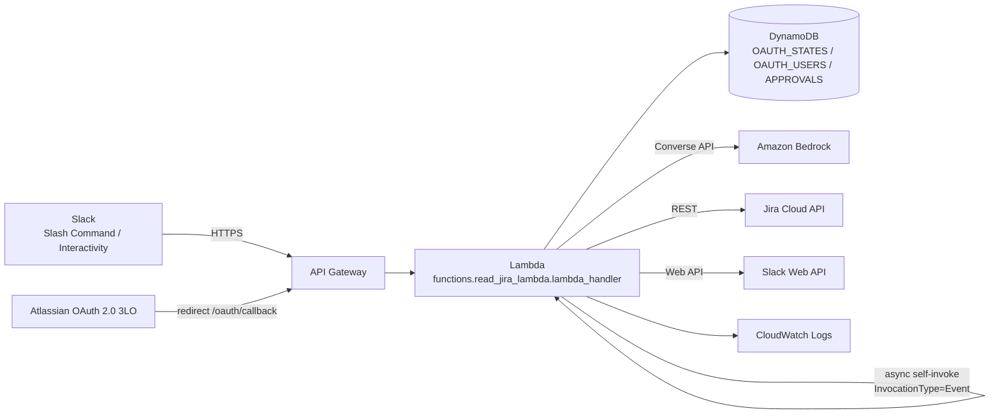

# Jira Slack Agent – modular MVP

## Current features
- `/jira-agent connect`: Atlassian OAuth 2.0 (3LO); the connection is stored per `slack_user_id`.
- `/jira-agent disconnect`: deletes the user's Jira connection and stored tokens. Tokens are also deleted automatically when Atlassian rejects the refresh token (`invalid_grant`).
- `/jira-agent list`: tickets assigned to the Jira account linked to the Slack user, total worklog time per ticket, and a Log Time button.
- `/jira-agent logwork today`: worklogs for the current day in the configured timezone, with total time and a Log Time button.
- Log Time modal: validates the form and creates an approval request; nothing is written to Jira yet.
- Approval: stores a PENDING record in DynamoDB and the bot sends the Approve/Reject buttons as a **private DM** to the requester (`APPROVAL_DELIVERY=dm`, default; `channel` posts in the channel instead); only the Slack user who created the request can approve or reject it. Approve uses a conditional update PENDING → EXECUTING to prevent repeated clicks, and only then creates the worklog.
- Bedrock Agent: uses the Converse API to turn natural-language commands into a JSON plan; the backend only executes intents on the allow-list. Natural-language requests run asynchronously so Slack gets an ACK within the time limit.
- Natural-language requests are rate-limited per user (`AGENT_RATE_LIMIT_PER_HOUR`, default 20) to cap Bedrock cost.
- Access token refresh, storing the new refresh token; expiry is stored as Unix seconds, with backward-compatible reads of old records stored in milliseconds.

## Structure
```text
functions/read_jira_lambda.py       # Lambda entry point
handlers/                           # Slack commands, actions, OAuth, async routing
agent/                               # Bedrock LLM adapter, orchestrator, allow-listed tools
jira/authentication_jira.py          # OAuth callback and Atlassian OAuth exchange
jira/jira_client.py                  # Jira REST transport
jira/jira_service.py                 # Jira business logic
jira/tasks/                          # Async task handlers
slack/                               # Slack API, security, modal, message blocks
approval/                            # Approval boundary scaffold
util/                                # DynamoDB, constants, common helpers
tests/
template.yaml                       # AWS SAM template (staging / prod stacks)
samconfig.toml                      # sam deploy --config-env staging|prod
.github/workflows/                  # CI (tests, guardrails, cfn-lint) and deploy (OIDC, staging auto, prod manual)
docs/deploy/RELEASE_CHECKLIST.md    # SSM secrets, Atlassian/Slack app setup, smoke test, retention, rollback
```

## Deploy
Infrastructure is defined in `template.yaml` (AWS SAM) and deployed by `.github/workflows/deploy.yml`:
every push to `main` deploys **staging**; **prod** is deployed manually and requires approval.
Follow `docs/deploy/RELEASE_CHECKLIST.md` for the one-time setup:

1. Store the four secrets as SecureString parameters under `/jira-agent/<stage>/` in SSM Parameter Store.
2. Configure GitHub environments (`staging`, `prod`) with an OIDC deploy role and the non-secret variables.
3. Deploy (`sam build && sam deploy --config-env staging ...`) and note the `ApiUrl` / `OAuthCallbackUrl` outputs.
4. Atlassian app: callback URL, scopes, and **Distribution → Sharing** so other users can authorize.
5. Slack app: request URLs, bot scopes, **App Home → Messages Tab** (approvals arrive as DMs).
6. Run the smoke test in the checklist.

## AWS Infrastructure

### Architecture overview


### Request flows and how they map to the project structure
| Flow | Entry point (API Gateway) | Code | Notes |
|---|---|---|---|
| Slash command `/jira-agent ...` | `POST /` (Slack Command URL) | `handlers/` → `jira/jira_service.py` | Verifies the signature using `slack/` security; ACKs quickly |
| Button click / modal submit | `POST /` (Slack Interactivity URL) | `handlers/` (actions) → `slack/` modal | The modal only creates an approval; nothing is written to Jira yet |
| Approve / Reject | `POST /` (Interactivity) | `approval/` → async task `handle_approval_action` | Conditional update `PENDING → EXECUTING`, then the worklog is created |
| Natural-language request | `POST /` (Slash command) | `agent/` (orchestrator, `tool_registry.py`) | Runs asynchronously via self-invoke so Slack gets an ACK within 3 seconds |
| Connect Jira | `GET /oauth/callback` | `jira/authentication_jira.py` | State is stored in `OAUTH_STATES_TABLE` |
| Async task | Lambda `Event` invocation (not via API Gateway) | `jira/tasks/` | The Lambda invokes itself |

### AWS resources
| Resource | Suggested configuration | Purpose |
|---|---|---|
| Lambda function | Python 3.12 runtime, handler `functions.read_jira_lambda.lambda_handler`, 512 MB memory, 30–60 s timeout | Handles all requests and async tasks |
| API Gateway (HTTP API or REST API) | Route `ANY /` or `POST /` for Slack, `GET /oauth/callback` for Atlassian; Lambda proxy integration | Public endpoint for Slack and Atlassian |
| DynamoDB `OAUTH_STATES_TABLE` | PK `state` (String), on-demand, **TTL enabled on attribute `expiresAt`** | OAuth state for CSRF protection (single-use, 10-minute lifetime) |
| DynamoDB `OAUTH_USERS_TABLE` | PK `slack_user_id` (String), on-demand | Access/refresh tokens, `jiraSiteUrl`, and cloud id per Slack user |
| DynamoDB `APPROVALS_TABLE` | PK `approval_id` (String), on-demand, **TTL enabled on attribute `ttl`** | Approval requests (`PENDING`/`EXECUTING`/...) |
| Amazon Bedrock | Model or inference profile via `BEDROCK_MODEL_ID`, region `BEDROCK_REGION` | Parses natural-language commands into a JSON plan |
| CloudWatch Logs | 14–30 day retention | Operational logs; **do not log tokens, Slack bodies, or worklog descriptions** |

> The code stores the OAuth state expiry in `expiresAt` (Unix seconds) on `OAUTH_STATES_TABLE`, and in `ttl` on `APPROVALS_TABLE`. Enable TTL on those attributes respectively, otherwise expired items are never cleaned up automatically.

### Lambda environment variables
The full list is in `.env.example`. The variables directly related to infrastructure:

| Variable | Meaning |
|---|---|
| `OAUTH_STATES_TABLE` | DynamoDB table name for OAuth state |
| `OAUTH_USERS_TABLE` | DynamoDB table name for per-Slack-user connections |
| `APPROVALS_TABLE` | DynamoDB table name for approvals (also holds short-lived `dedupe#…` rows that block identical requests for 24 h) |
| `APPROVAL_RETENTION_DAYS` | Optional, default `90`. How long finished approvals (approved, rejected, failed, cancelled) are kept as an audit trail before TTL deletes them |
| `MAX_WORKLOG_MINUTES` | Optional, default `1440` (24h). Largest duration a single worklog may have; `1d` = 8h and `1w` = 5d, as in Jira's defaults |
| `BEDROCK_MODEL_ID` | Model ID or inference profile ID |
| `BEDROCK_REGION` | Region used to call Bedrock |
| `SSM_PARAMETER_PREFIX` | e.g. `/jira-agent/prod/`. When set, the four secrets are read from SSM Parameter Store (SecureString) and environment values for them are ignored. Unset for local development and tests |
| `SECRET_CACHE_SECONDS` | Optional, default `300`. How long secrets are cached before SSM is read again (rotation delay) |
| `APPROVAL_DELIVERY` | Optional, `dm` (default) or `channel` |
| `RATE_LIMITS_TABLE` | DynamoDB table for per-user rate limits (PK `limit_key`, TTL `ttl`). Unset = no limit |
| `AGENT_RATE_LIMIT_PER_HOUR` | Optional, default `20`. `0` disables the limit |

> Secrets (`SLACK_SIGNING_SECRET`, `SLACK_BOT_TOKEN`, `ATLASSIAN_CLIENT_SECRET`, `ASYNC_TASK_SECRET`) are read only through `util/config.get_secret`: from SSM Parameter Store in AWS (`/jira-agent/<stage>/slack-signing-secret`, ...), from the environment locally. Guardrail G9 fails the build if code reads them from `os.environ`.

### IAM – Lambda execution role (least privilege)
Replace the placeholders `<REGION>`, `<ACCOUNT_ID>`, `<FUNCTION_NAME>`, and `<MODEL_ARN_OR_PROFILE_ARN>`:

```json
{
  "Version": "2012-10-17",
  "Statement": [
    {
      "Sid": "Logs",
      "Effect": "Allow",
      "Action": ["logs:CreateLogGroup", "logs:CreateLogStream", "logs:PutLogEvents"],
      "Resource": "arn:aws:logs:<REGION>:<ACCOUNT_ID>:log-group:/aws/lambda/<FUNCTION_NAME>:*"
    },
    {
      "Sid": "DynamoDB",
      "Effect": "Allow",
      "Action": ["dynamodb:GetItem", "dynamodb:PutItem", "dynamodb:UpdateItem", "dynamodb:DeleteItem"],
      "Resource": [
        "arn:aws:dynamodb:<REGION>:<ACCOUNT_ID>:table/<OAUTH_STATES_TABLE>",
        "arn:aws:dynamodb:<REGION>:<ACCOUNT_ID>:table/<OAUTH_USERS_TABLE>",
        "arn:aws:dynamodb:<REGION>:<ACCOUNT_ID>:table/<APPROVALS_TABLE>"
      ]
    },
    {
      "Sid": "SelfInvokeForAsyncTasks",
      "Effect": "Allow",
      "Action": "lambda:InvokeFunction",
      "Resource": "arn:aws:lambda:<REGION>:<ACCOUNT_ID>:function:<FUNCTION_NAME>"
    },
    {
      "Sid": "BedrockInvoke",
      "Effect": "Allow",
      "Action": "bedrock:InvokeModel",
      "Resource": "<MODEL_ARN_OR_PROFILE_ARN>"
    }
  ]
}
```
If you use a cross-region inference profile, allow both the profile ARN and the foundation models the profile routes to. If the code uses `Query`/`Scan` or a GSI, add the corresponding actions.

### AWS SAM template
`template.yaml` creates the function (reserved concurrency, async retries disabled with an encrypted SQS
failure queue), the HTTP API (throttling), the four DynamoDB tables (TTL, encryption, point-in-time recovery,
`Retain`), the log group, and alarms on errors, throttles, duration and failed async tasks.
Its invariants are pinned by `tests/test_infrastructure.py`; CI also runs `cfn-lint`.

### Post-deployment checklist
1. Take the API URL from the stack output and enter it as the Slack Slash Command Request URL and Interactivity Request URL.
2. Set the Atlassian redirect URI to `<API URL>/oauth/callback` (it must match exactly).
3. Enable model access in the Bedrock console for `BEDROCK_MODEL_ID` in `BEDROCK_REGION`.
4. Confirm TTL is Enabled on `APPROVALS_TABLE` (attribute `ttl`) and on `OAUTH_STATES_TABLE` (attribute `expiresAt`).
5. Set CloudWatch log retention and (recommended) alarms on Lambda `Errors`, `Throttles`, and `Duration`.
6. Consider Reserved Concurrency and API Gateway throttling to cap Bedrock costs if the endpoint is spammed.

## Before going to production
- Bedrock only proposes JSON intents/parameters. `agent/tool_registry.py` validates the allow-list and the data; the model is never allowed to call the Jira API.
- Every worklog write path from the modal now goes through the Approval Service. Do not use the old `create_jira_worklog` task directly; only the async task `handle_approval_action` may execute a write, and only after successfully claiming the approval.
- Every worklog creation request from the Agent goes through ApprovalService; the model must not call the Jira write API directly. Python still validates and enforces approval.
- The refresh lock is a DynamoDB conditional update (`refreshLockOwner` / `refreshLockUntil`, 30-second lease) that reduces concurrent token refreshes; you should still test with a real DynamoDB and with Lambda retries. Do not log OAuth tokens, Slack bodies, or worklog descriptions.
- Approve/Reject results are sent to the clicking user as an ephemeral message; the original approval message is replaced only after a successful approve or reject, so other users cannot wipe the owner's buttons. If executing an approved worklog fails, the user is told to check Jira before submitting again and the task is not retried by Lambda.
- The MVP stores one Jira site per Slack user; reconnecting to a different site replaces the previous connection.
- Jira issue links are built from each Slack user's `jiraSiteUrl`; do not use a global URL if one is already present in the OAuth record.
- Run unit/integration tests against a Jira sandbox before deploying to production.
