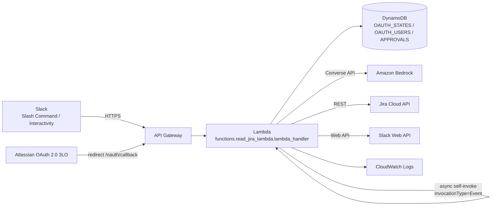

# Jira Slack Agent – modular MVP

## Current features
- `/jira-agent connect`: Atlassian OAuth 2.0 (3LO); the connection is stored per `slack_user_id`.
- `/jira-agent list`: tickets assigned to the Jira account linked to the Slack user, total worklog time per ticket, and a Log Time button.
- `/jira-agent logwork today`: worklogs for the current day in the configured timezone, with total time and a Log Time button.
- Log Time modal: validates the form and creates an approval request; nothing is written to Jira yet.
- Approval: stores a PENDING record in DynamoDB and Slack sends Approve/Reject buttons; only the Slack user who created the request can approve or reject it. Approve uses a conditional update PENDING → EXECUTING to prevent repeated clicks, and only then creates the worklog.
- Bedrock Agent: uses the Converse API to turn natural-language commands into a JSON plan; the backend only executes intents on the allow-list. Natural-language requests run asynchronously so Slack gets an ACK within the time limit.
- Access token refresh, storing the new refresh token; expiry is stored as Unix seconds, with backward-compatible reads of old records stored in milliseconds.

## Structure
```text
functions/read_jira_lambda.py       # Lambda entry point
handlers/                           # Slack commands, actions, OAuth, async routing
agent/                               # Bedrock LLM adapter, orchestrator, allow-listed tools
jira/authentication_jira.py          # OAuth callback and Atlassian OAuth exchange
jira/jira_client.py                  # Jira REST transport
jira/jira_service.py                 # Jira business logic
jira/tasks/                          # Async task handlers
slack/                               # Slack API, security, modal, message blocks
approval/                            # Approval boundary scaffold
util/                                # DynamoDB, constants, common helpers
tests/
template.yaml                       # (optional) AWS SAM template, see the AWS Infrastructure section
```

## Deploy
1. Set the Lambda handler to `functions.read_jira_lambda.lambda_handler`.
2. Upload the whole source tree (or a ZIP) together with `requirements.txt` / a dependency layer that includes `boto3`.
3. Configure the variables from `.env.example` on the Lambda function.
4. Create the DynamoDB tables: `OAUTH_STATES_TABLE` with string partition key `state`; `OAUTH_USERS_TABLE` with string partition key `slack_user_id`; `APPROVALS_TABLE` with string partition key `approval_id`. Enable DynamoDB TTL on the `ttl` attribute of the approvals table.
5. Point the Slack Slash Command Request URL and Interactivity Request URL at the API Gateway endpoint integrated with the Lambda; the Atlassian OAuth redirect URI must exactly match the API Gateway URL plus `/oauth/callback`.
6. The Lambda execution role needs DynamoDB permissions on the tables, `lambda:InvokeFunction` on the function itself, and `bedrock:InvokeModel` for the chosen model/inference profile.
7. Add `BEDROCK_MODEL_ID` and `BEDROCK_REGION` for the chosen model. See `docs/BEDROCK_SETUP.md` for detailed setup.
8. The Slack app needs `commands`, `chat:write`, `chat:write.public` if needed, and `views:write`; enable Interactivity and use the API Gateway endpoint.

## AWS Infrastructure

### Architecture overview


### Request flows and how they map to the project structure
| Flow | Entry point (API Gateway) | Code | Notes |
|---|---|---|---|
| Slash command `/jira-agent ...` | `POST /` (Slack Command URL) | `handlers/` → `jira/jira_service.py` | Verifies the signature using `slack/` security; ACKs quickly |
| Button click / modal submit | `POST /` (Slack Interactivity URL) | `handlers/` (actions) → `slack/` modal | The modal only creates an approval; nothing is written to Jira yet |
| Approve / Reject | `POST /` (Interactivity) | `approval/` → async task `handle_approval_action` | Conditional update `PENDING → EXECUTING`, then the worklog is created |
| Natural-language request | `POST /` (Slash command) | `agent/` (orchestrator, `tool_registry.py`) | Runs asynchronously via self-invoke so Slack gets an ACK within 3 seconds |
| Connect Jira | `GET /oauth/callback` | `jira/authentication_jira.py` | State is stored in `OAUTH_STATES_TABLE` |
| Async task | Lambda `Event` invocation (not via API Gateway) | `jira/tasks/` | The Lambda invokes itself |

### AWS resources
| Resource | Suggested configuration | Purpose |
|---|---|---|
| Lambda function | Python 3.12 runtime, handler `functions.read_jira_lambda.lambda_handler`, 512 MB memory, 30–60 s timeout | Handles all requests and async tasks |
| API Gateway (HTTP API or REST API) | Route `ANY /` or `POST /` for Slack, `GET /oauth/callback` for Atlassian; Lambda proxy integration | Public endpoint for Slack and Atlassian |
| DynamoDB `OAUTH_STATES_TABLE` | PK `state` (String), on-demand | OAuth state for CSRF protection |
| DynamoDB `OAUTH_USERS_TABLE` | PK `slack_user_id` (String), on-demand | Access/refresh tokens, `jiraSiteUrl`, and cloud id per Slack user |
| DynamoDB `APPROVALS_TABLE` | PK `approval_id` (String), on-demand, **TTL enabled on attribute `ttl`** | Approval requests (`PENDING`/`EXECUTING`/...) |
| Amazon Bedrock | Model or inference profile via `BEDROCK_MODEL_ID`, region `BEDROCK_REGION` | Parses natural-language commands into a JSON plan |
| CloudWatch Logs | 14–30 day retention | Operational logs; **do not log tokens, Slack bodies, or worklog descriptions** |

> If the code also writes a `ttl` attribute to `OAUTH_STATES_TABLE`, enable TTL on that table too so expired states are cleaned up.

### Lambda environment variables
The full list is in `.env.example`. The variables directly related to infrastructure:

| Variable | Meaning |
|---|---|
| `OAUTH_STATES_TABLE` | DynamoDB table name for OAuth state |
| `OAUTH_USERS_TABLE` | DynamoDB table name for per-Slack-user connections |
| `APPROVALS_TABLE` | DynamoDB table name for approvals |
| `BEDROCK_MODEL_ID` | Model ID or inference profile ID |
| `BEDROCK_REGION` | Region used to call Bedrock |

> Production recommendation: keep the Slack signing secret, Atlassian client secret, and other sensitive values in AWS Secrets Manager or SSM Parameter Store (SecureString) instead of plain environment variables, and grant the execution role the matching read permissions.

### IAM – Lambda execution role (least privilege)
Replace the placeholders `<REGION>`, `<ACCOUNT_ID>`, `<FUNCTION_NAME>`, and `<MODEL_ARN_OR_PROFILE_ARN>`:

```json
{
  "Version": "2012-10-17",
  "Statement": [
    {
      "Sid": "Logs",
      "Effect": "Allow",
      "Action": ["logs:CreateLogGroup", "logs:CreateLogStream", "logs:PutLogEvents"],
      "Resource": "arn:aws:logs:<REGION>:<ACCOUNT_ID>:log-group:/aws/lambda/<FUNCTION_NAME>:*"
    },
    {
      "Sid": "DynamoDB",
      "Effect": "Allow",
      "Action": ["dynamodb:GetItem", "dynamodb:PutItem", "dynamodb:UpdateItem", "dynamodb:DeleteItem"],
      "Resource": [
        "arn:aws:dynamodb:<REGION>:<ACCOUNT_ID>:table/<OAUTH_STATES_TABLE>",
        "arn:aws:dynamodb:<REGION>:<ACCOUNT_ID>:table/<OAUTH_USERS_TABLE>",
        "arn:aws:dynamodb:<REGION>:<ACCOUNT_ID>:table/<APPROVALS_TABLE>"
      ]
    },
    {
      "Sid": "SelfInvokeForAsyncTasks",
      "Effect": "Allow",
      "Action": "lambda:InvokeFunction",
      "Resource": "arn:aws:lambda:<REGION>:<ACCOUNT_ID>:function:<FUNCTION_NAME>"
    },
    {
      "Sid": "BedrockInvoke",
      "Effect": "Allow",
      "Action": "bedrock:InvokeModel",
      "Resource": "<MODEL_ARN_OR_PROFILE_ARN>"
    }
  ]
}
```
If you use a cross-region inference profile, allow both the profile ARN and the foundation models the profile routes to. If the code uses `Query`/`Scan` or a GSI, add the corresponding actions.

### AWS SAM template example
A minimal example; adjust as needed (`template.yaml` at the project root):

```yaml
AWSTemplateFormatVersion: "2010-09-09"
Transform: AWS::Serverless-2016-10-31

Parameters:
  BedrockModelId: { Type: String }
  BedrockRegion:  { Type: String, Default: ap-southeast-1 }

Resources:
  OAuthStatesTable:
    Type: AWS::DynamoDB::Table
    Properties:
      BillingMode: PAY_PER_REQUEST
      AttributeDefinitions: [{ AttributeName: state, AttributeType: S }]
      KeySchema: [{ AttributeName: state, KeyType: HASH }]

  OAuthUsersTable:
    Type: AWS::DynamoDB::Table
    Properties:
      BillingMode: PAY_PER_REQUEST
      AttributeDefinitions: [{ AttributeName: slack_user_id, AttributeType: S }]
      KeySchema: [{ AttributeName: slack_user_id, KeyType: HASH }]

  ApprovalsTable:
    Type: AWS::DynamoDB::Table
    Properties:
      BillingMode: PAY_PER_REQUEST
      AttributeDefinitions: [{ AttributeName: approval_id, AttributeType: S }]
      KeySchema: [{ AttributeName: approval_id, KeyType: HASH }]
      TimeToLiveSpecification: { AttributeName: ttl, Enabled: true }

  JiraAgentFunction:
    Type: AWS::Serverless::Function
    Properties:
      Handler: functions.read_jira_lambda.lambda_handler
      Runtime: python3.12
      CodeUri: .
      MemorySize: 512
      Timeout: 60
      Environment:
        Variables:
          OAUTH_STATES_TABLE: !Ref OAuthStatesTable
          OAUTH_USERS_TABLE: !Ref OAuthUsersTable
          APPROVALS_TABLE: !Ref ApprovalsTable
          BEDROCK_MODEL_ID: !Ref BedrockModelId
          BEDROCK_REGION: !Ref BedrockRegion
          # Add the remaining variables from .env.example
      Policies:
        - DynamoDBCrudPolicy: { TableName: !Ref OAuthStatesTable }
        - DynamoDBCrudPolicy: { TableName: !Ref OAuthUsersTable }
        - DynamoDBCrudPolicy: { TableName: !Ref ApprovalsTable }
        - LambdaInvokePolicy: { FunctionName: !Ref JiraAgentFunction }
        - Statement:
            - Effect: Allow
              Action: bedrock:InvokeModel
              Resource: "*"   # Narrow to the model/profile ARN for production
      Events:
        Slack:
          Type: HttpApi
          Properties: { Path: /, Method: POST }
        OAuthCallback:
          Type: HttpApi
          Properties: { Path: /oauth/callback, Method: GET }

Outputs:
  ApiUrl:
    Value: !Sub "https://${ServerlessHttpApi}.execute-api.${AWS::Region}.amazonaws.com"
```
> `LambdaInvokePolicy` pointing at the function itself can create a circular dependency in CloudFormation. If you hit that error, give the function a fixed name and build the ARN with `!Sub` in a separate statement.

### Post-deployment checklist
1. Take the API URL from the stack output and enter it as the Slack Slash Command Request URL and Interactivity Request URL.
2. Set the Atlassian redirect URI to `<API URL>/oauth/callback` (it must match exactly).
3. Enable model access in the Bedrock console for `BEDROCK_MODEL_ID` in `BEDROCK_REGION`.
4. Confirm TTL on `APPROVALS_TABLE` is Enabled.
5. Set CloudWatch log retention and (recommended) alarms on Lambda `Errors`, `Throttles`, and `Duration`.
6. Consider Reserved Concurrency and API Gateway throttling to cap Bedrock costs if the endpoint is spammed.

## Before going to production
- Bedrock only proposes JSON intents/parameters. `agent/tool_registry.py` validates the allow-list and the data; the model is never allowed to call the Jira API.
- Every worklog write path from the modal now goes through the Approval Service. Do not use the old `create_jira_worklog` task directly; only the async task `handle_approval_action` may execute a write, and only after successfully claiming the approval.
- Every worklog creation request from the Agent goes through ApprovalService; the model must not call the Jira write API directly. Python still validates and enforces approval.
- The refresh lock reduces concurrent token refreshes; you should still test with a real DynamoDB and with Lambda retries. Do not log OAuth tokens, Slack bodies, or worklog descriptions.
- The MVP stores one Jira site per Slack user; reconnecting to a different site replaces the previous connection.
- Jira issue links are built from each Slack user's `jiraSiteUrl`; do not use a global URL if one is already present in the OAuth record.
- Run unit/integration tests against a Jira sandbox before deploying to production.
