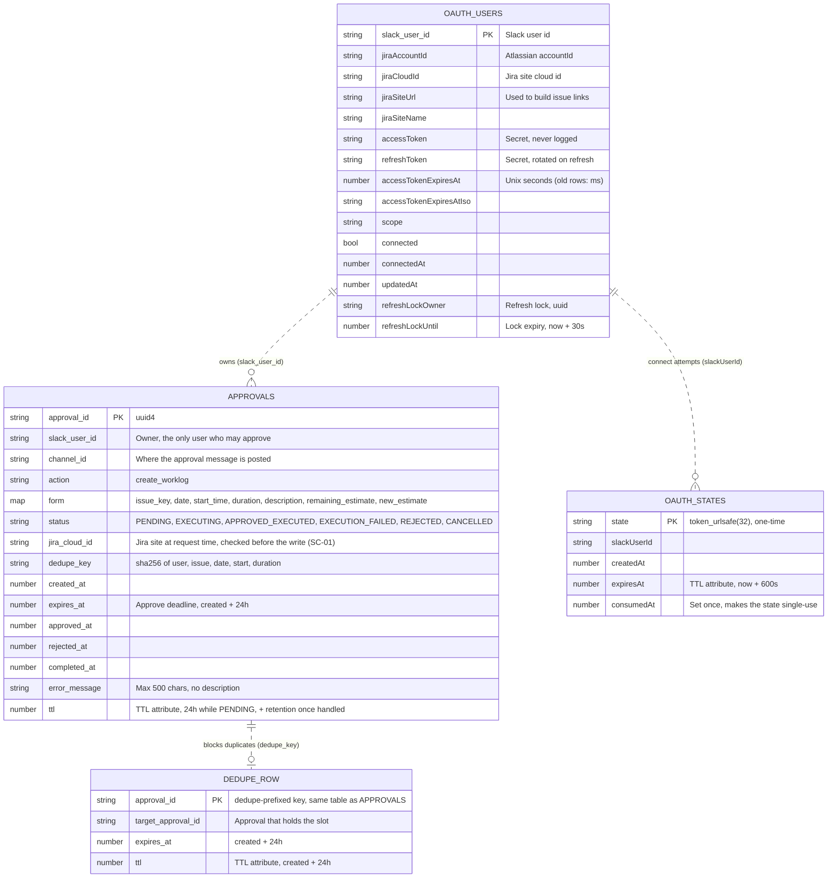
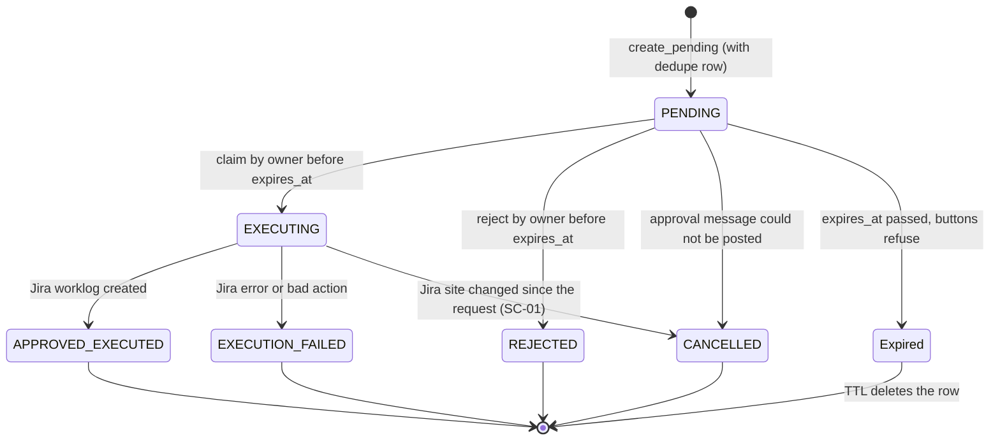
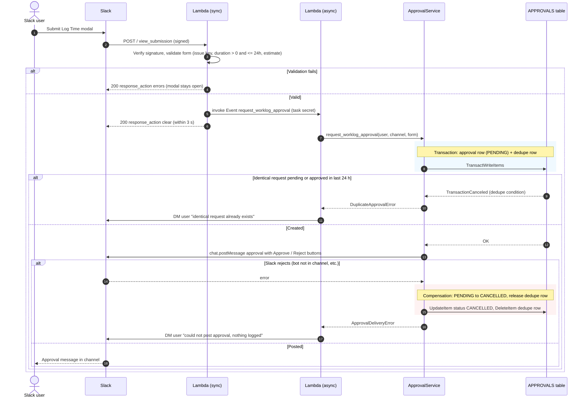
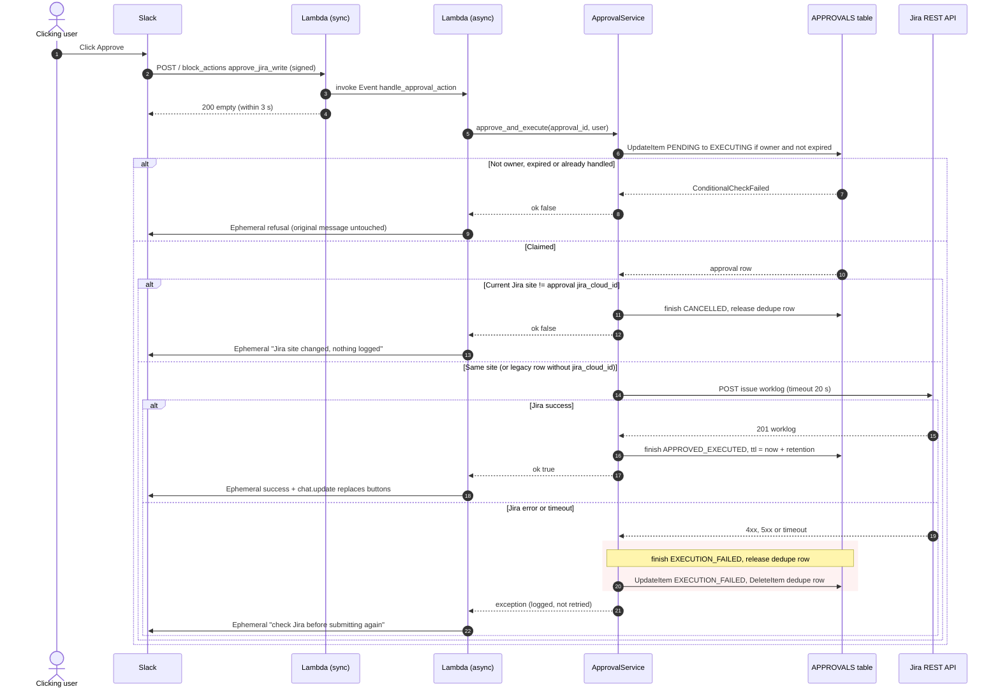
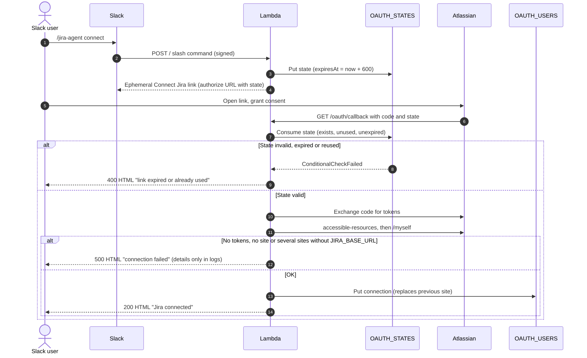
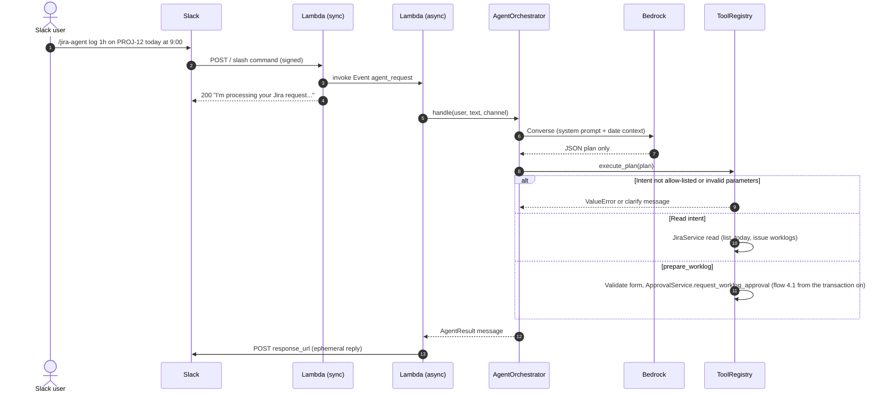

# Data Model & Processing Flows – Jira Agent Slack Bot

Describes the code as of the GAP-01/02/05/08 fixes. Source of truth: `approval/`, `util/dynamo_helper.py`,
`jira/authentication_jira.py`, `handlers/`, `agent/tool_registry.py`.

## 1. Data model (DynamoDB)

Three tables, each with a single string partition key and on-demand capacity. There are **no GSIs, no sort
keys and no scans**: every read and write is by primary key.

> **Deviation from the house template.** The template's `id / version / created_at / updated_at / deleted_at`
> columns do not apply:
> - concurrency control uses **conditional writes** (`ConditionExpression`) and transactions instead of a
>   `version` column;
> - deletion is done by **DynamoDB TTL** (`ttl`, `expiresAt`) instead of soft delete (`deleted_at`);
> - relations are **logical only** (DynamoDB has no foreign keys), shown dashed below.

`DEDUPE_ROW` is not a separate table: it lives in `APPROVALS_TABLE` with key `dedupe#<dedupe_key>`. It has
no `status`, so it can never satisfy the claim/reject conditions even if its key were clicked as an
approval id.

### Access patterns and conditions

| Table | Operation | Key | Condition / guarantee | Code |
|---|---|---|---|---|
| `OAUTH_STATES` | Put state | `state` | `attribute_not_exists(state)` | `DynamoHelper.create_oauth_authorization_url` |
| `OAUTH_STATES` | Consume state | `state` | exists, `consumedAt` not set, `expiresAt > now` (single use) | `DynamoHelper.consume_oauth_state` |
| `OAUTH_USERS` | Put connection | `slack_user_id` | Unconditional put: reconnecting replaces the old site (one site per user) | `AuthenticationJira.finish_oauth_callback` |
| `OAUTH_USERS` | Read account / credentials | `slack_user_id` | `ConsistentRead` | `DynamoHelper.get_jira_account_id_for_slack_user`, `get_oauth_credentials` |
| `OAUTH_USERS` | Take refresh lock | `slack_user_id` | no lock, lock expired, or we own it | `DynamoHelper.refresh_access_token` |
| `OAUTH_USERS` | Store refreshed tokens | `slack_user_id` | `refreshLockOwner = me`, removes the lock | `DynamoHelper.refresh_access_token` |
| `APPROVALS` | Create approval + dedupe row | `approval_id` ×2 | **Transaction**: new approval id, and no live dedupe row (`attribute_not_exists OR expires_at <= now`) | `ApprovalRepository.create_pending` |
| `APPROVALS` | Claim / reject | `approval_id` | `status = PENDING AND slack_user_id = caller AND expires_at > now` | `ApprovalRepository.claim`, `reject` |
| `APPROVALS` | Cancel undelivered | `approval_id` | `status = PENDING` | `ApprovalRepository.cancel` |
| `APPROVALS` | Finish | `approval_id` | `status = EXECUTING` | `ApprovalRepository.finish` |
| `APPROVALS` | Release dedupe row | `dedupe#…` | `target_approval_id = this approval` (never frees a newer request's slot) | `ApprovalRepository.release_dedupe` |

### Retention

| Item | Removed by | When |
|---|---|---|
| OAuth state | TTL on `expiresAt` | 10 min after creation (single use even before that) |
| Pending approval | TTL on `ttl` | 24 h after creation if never handled (the Approve button stops working at `expires_at`) |
| Handled approval | TTL on `ttl` | `APPROVAL_RETENTION_DAYS` (default 90) after the last status change – audit trail |
| Dedupe row | TTL on `ttl`, or deleted on reject / cancel / failure | 24 h after creation |
| Jira connection | Never (no disconnect yet – see spec gap GAP-04) | – |

DynamoDB TTL deletes lazily (usually within 48 h), so every expiry is also enforced in a condition
(`expires_at > now`, `expiresAt > now`) instead of relying on the row being gone.

## 2. Approval state machine

- Only `PENDING → EXECUTING` leads to a Jira write, and only `handle_approval_action` performs it.
- Site binding (SC-01): `jira_cloud_id` is stored at creation. After the claim, it is compared with the cloud
  id of the credentials that will perform the write; on a mismatch (user reconnected to another site) the
  approval ends `CANCELLED` and nothing is written. Rows created before SC-01 have no `jira_cloud_id` and are
  not checked.
- The dedupe row is released on `REJECTED`, `CANCELLED` and `EXECUTION_FAILED`, so the user can resubmit.
  After `APPROVED_EXECUTED` it keeps blocking an identical worklog for 24 h.
- `Expired` is not stored: the row stays `PENDING` until TTL removes it, and the time check in the condition
  refuses any click.
- Known gap (TC-29 / GAP-07): if Jira accepted the worklog but writing `APPROVED_EXECUTED` fails, the row ends
  `EXECUTION_FAILED` even though the worklog exists. In that case the dedupe row is **kept**, so the same
  worklog cannot be resubmitted for 24 h. The user is told to check Jira before retrying.
- A Slack timeout while posting the approval leaves it `PENDING` (Slack may have posted it). Only a definite
  Slack error (`ok: false` or an HTTP error) cancels it.

## 3. Layer structure

```mermaid
classDiagram
    direction LR
    class lambda_handler {
        +route(event) response
    }
    class SlackCommandHandler {
        +handle_slack_request()
    }
    class SlackActionHandler {
        +handle_block_actions()
        +handle_view_submission()
    }
    class AsyncTaskHandler {
        +handle_async_task(event)
    }
    class AgentOrchestrator {
        +handle(user, text, channel) AgentResult
    }
    class BedrockLLMClient {
        +generate_plan(prompt, text) dict
    }
    class ToolRegistry {
        +execute_plan(plan, user, channel) dict
    }
    class ApprovalService {
        +request_worklog_approval()
        +approve_and_execute()
        +reject()
    }
    class ApprovalRepository {
        +create_pending()
        +claim()
        +reject()
        +cancel()
        +finish()
        +release_dedupe()
    }
    class JiraService {
        +find_assigned_issues()
        +fetch_today_worklogs()
        +create_worklog()
    }
    class JiraClient {
        +request(path)
    }
    class DynamoHelper {
        +get_oauth_credentials()
        +refresh_access_token()
        +consume_oauth_state()
    }
    lambda_handler --> SlackCommandHandler : signed Slack request
    lambda_handler --> AsyncTaskHandler : async event + secret
    SlackCommandHandler --> SlackActionHandler : interactivity payload
    AsyncTaskHandler --> AgentOrchestrator : agent_request
    AsyncTaskHandler --> ApprovalService : approval tasks
    AgentOrchestrator --> BedrockLLMClient : plan only
    AgentOrchestrator --> ToolRegistry : validated plan
    ToolRegistry --> ApprovalService : prepare_worklog
    ToolRegistry --> JiraService : read intents
    ApprovalService --> ApprovalRepository
    ApprovalService --> JiraService : write after claim
    JiraService --> JiraClient
    JiraClient --> DynamoHelper : tokens
```

The model never reaches `JiraService` directly: `ToolRegistry` validates the plan against `ALLOWED_INTENTS`,
and the only write it can trigger is creating a PENDING approval.

## 4. Sequence diagrams

### 4.1 Log Time modal → approval request (GAP-01, GAP-02, GAP-08)

### 4.2 Approve → Jira worklog (the only write path)

### 4.3 Connect Jira (OAuth 2.0 3LO)

### 4.4 Natural-language request (agent)

## 5. Processing steps – worklog from request to Jira

| Step | Layer | Action | Exception / branch | Result & compensation |
|:-:|---|---|---|---|
| 1 | `lambda_handler` | Verify Slack signature and timestamp (±300 s) | Bad or missing signature | `401 invalid Slack signature` |
| 2 | `SlackActionHandler` / `ToolRegistry` | Validate form: issue key pattern, date, start time, `0 < duration <= MAX_WORKLOG_MINUTES`, estimate option | Invalid field | Modal: `errors` per block. Agent: clarify message. Nothing stored |
| 3 | `SlackActionHandler` | Invoke async task, ACK Slack | Invoke throttled | `500` to Slack (`dispatch_failed`), see GAP-14 |
| 4 | `ApprovalRepository` (transaction) | Create PENDING approval and dedupe row | Live dedupe row exists | `DuplicateApprovalError` → user notified, nothing stored |
| 5 | `ApprovalService` | Post Approve/Reject message | Slack error | Cancel approval and release dedupe row → `ApprovalDeliveryError` → user notified |
| 6 | `ApprovalRepository` | Owner clicks Approve: conditional claim to EXECUTING | Not owner, expired, already handled | Ephemeral refusal, row unchanged |
| 6b | `ApprovalService` | Compare `jira_cloud_id` with the site of the write credentials | Site changed (reconnect) | `CANCELLED`, dedupe released, user told nothing was logged (SC-01) |
| 7 | `JiraService` | POST worklog | Jira error or timeout | `EXECUTION_FAILED`, dedupe released, user told to check Jira. Not retried by Lambda |
| 8 | `ApprovalRepository` | Finish `APPROVED_EXECUTED`, extend `ttl` to retention | DynamoDB error after Jira success | Known gap TC-29: row ends `EXECUTION_FAILED` |
| 9 | `AsyncTaskHandler` | Notify user, replace buttons on success | Slack error | Logged only, best effort |
