# Data Model & Processing Flows – Jira Agent Slack Bot

Describes the code and infrastructure as of the release-readiness work (DM approvals, Jira site binding,
disconnect / revoked tokens, per-user rate limit, SSM secrets, SAM + GitHub OIDC deploy).
Sources of truth: `functions/`, `handlers/`, `approval/`, `agent/`, `jira/`, `util/`, `template.yaml`,
`infra/github-oidc-bootstrap.yaml`. Setup steps: `docs/deploy/RELEASE_CHECKLIST.md`.

## 0. System context

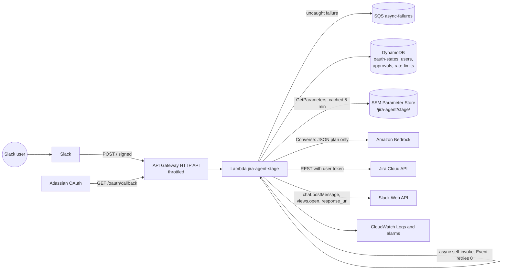

**One Lambda, three entry types** (`functions/read_jira_lambda.py`):

| Entry | Recognised by | Authentication | Routed to |
|---|---|---|---|
| OAuth callback | `GET …/oauth/callback` | one-time `state` stored in DynamoDB | `jira/authentication_jira.py` |
| Async task | event has `_async_task` | `_task_secret` equals `ASYNC_TASK_SECRET` (constant-time), else 403 | `handlers/async_task_handler.py` |
| Slack request | anything else | Slack v0 HMAC signature, timestamp within 300 s, else 401 | `handlers/slack_command_handler.py` |

Slack must receive an answer within 3 s, so every slow operation (Bedrock, Jira, Slack posts) runs in an
async self-invocation: the synchronous call validates and acknowledges, the async call does the work.

Secrets (`SLACK_SIGNING_SECRET`, `SLACK_BOT_TOKEN`, `ATLASSIAN_CLIENT_SECRET`, `ASYNC_TASK_SECRET`) are read only via
`util/config.get_secret`: from SSM SecureString `/jira-agent/<stage>/<kebab-name>` in AWS (one decrypted
`GetParameters` call, cached `SECRET_CACHE_SECONDS`), from environment variables locally.

## 1. Data model (DynamoDB)

Four tables, `jira-agent-<stage>-<name>`, each with a single string partition key, on-demand capacity and
encryption at rest. There are **no GSIs, no sort keys and no scans**: every read and write is by primary key.

> **Deviation from the generic template.** No `id / version / created_at / updated_at / deleted_at` columns:
> concurrency uses **conditional writes and transactions**, deletion uses **TTL**, and relations are
> **logical only** (dashed below).

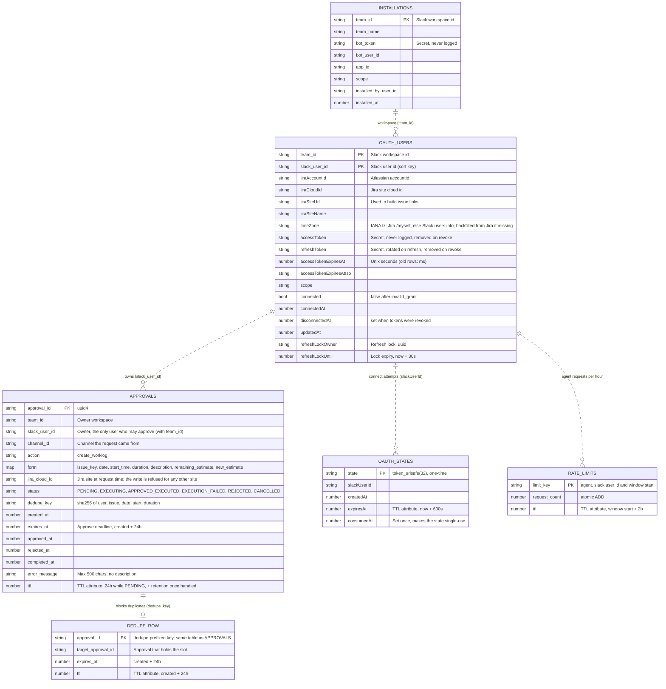

`DEDUPE_ROW` lives in the approvals table with key `dedupe#<dedupe_key>`. It has no `status`, so it can never
satisfy the claim or reject conditions even if its key were sent as an approval id.

### Access patterns and conditions

| Table | Operation | Condition / guarantee | Code |
|---|---|---|---|
| `oauth-states` | Put state | `attribute_not_exists(state)` | `DynamoHelper.create_oauth_authorization_url` |
| `oauth-states` | Consume state | exists, `consumedAt` not set, `expiresAt > now` (single use) | `DynamoHelper.consume_oauth_state` |
| `users` | Put connection | unconditional: reconnecting replaces the previous site (one site per user) | `AuthenticationJira.finish_oauth_callback` |
| `users` | Read account id / cloud id | `ConsistentRead`; projection of that attribute plus `connected` only (never tokens); `connected = false` counts as not connected | `DynamoHelper._read_connection` |
| `users` | Read credentials | `ConsistentRead`; refresh when the token expires within 60 s | `DynamoHelper.get_oauth_credentials` |
| `users` | Take refresh lock | no lock, lock expired, or we own it | `DynamoHelper.refresh_access_token` |
| `users` | Store refreshed tokens | `refreshLockOwner = me`, removes the lock | `DynamoHelper.refresh_access_token` |
| `users` | Forget revoked tokens | `refreshLockOwner = me`; removes tokens and lock, sets `connected = false` | `DynamoHelper._forget_tokens` |
| `users` | Disconnect | delete item (`ReturnValues=ALL_OLD`) | `DynamoHelper.disconnect_slack_user` |
| `approvals` | Create approval + dedupe row | **transaction**: new approval id, and no live dedupe row (`attribute_not_exists OR expires_at <= now`) | `ApprovalRepository.create_pending` |
| `approvals` | Claim / reject | `status = PENDING AND slack_user_id = caller AND expires_at > now`; extends `ttl` to retention | `ApprovalRepository.claim`, `reject` |
| `approvals` | Cancel undelivered | `status = PENDING` | `ApprovalRepository.cancel` |
| `approvals` | Finish (incl. CANCELLED on site change) | `status = EXECUTING`; extends `ttl` to retention | `ApprovalRepository.finish` |
| `approvals` | Release dedupe row | `target_approval_id = this approval` (never frees a newer request's slot) | `ApprovalRepository.release_dedupe` |
| `rate-limits` | Count a request | `ADD count`, condition `attribute_not_exists(count) OR count < limit`; failure = limited; other errors fail open | `RateLimiter.allow` |

### Retention

| Item | Removed by | When |
|---|---|---|
| OAuth state | TTL on `expiresAt` | 10 min after creation (single use even before that) |
| Jira connection and tokens | `/jira-agent disconnect` (row deleted), or `invalid_grant` (tokens deleted, row kept as disconnected) | on demand |
| Pending approval | TTL on `ttl` | 24 h after creation if never handled |
| Handled approval | TTL on `ttl` | `APPROVAL_RETENTION_DAYS` (default 90) after the last status change (audit trail) |
| Dedupe row | TTL, or deleted on reject / cancel / Jira failure | 24 h after creation |
| Rate-limit counter | TTL on `ttl` | 2 h after the window started |
| Failed async payload | SQS retention | 4 days (encrypted; contains the task secret and the form) |
| Logs | CloudWatch retention | `LogRetentionDays` (default 30) |

DynamoDB TTL deletes lazily (usually within 48 h), so every expiry is also enforced in a condition
(`expires_at > now`, `expiresAt > now`) instead of relying on the row being gone.

## 2. Approval state machine

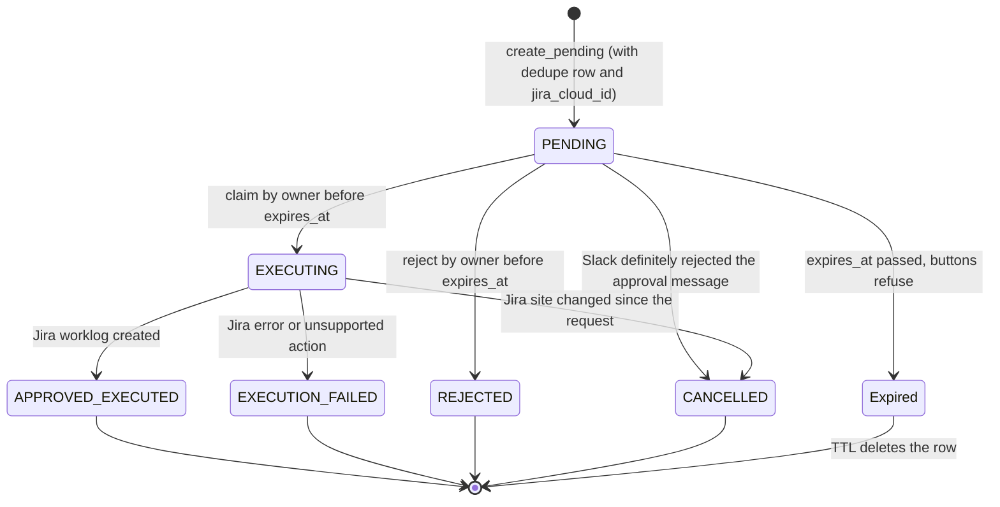

- Only `PENDING → EXECUTING` leads to a Jira write, and only the async task `handle_approval_action` performs it.
- **Site binding:** the approval stores the user's `jira_cloud_id` at request time. After the claim, the service
  compares it with the cloud id of the credentials it will write with; a reconnect to another site ends the
  approval as `CANCELLED` without writing. Approvals created before this field existed are not checked.
- **Dedupe row:** released on `REJECTED`, `CANCELLED` (undelivered) and `EXECUTION_FAILED` when Jira did not write,
  so the user can resubmit. Kept after `APPROVED_EXECUTED`, and kept when Jira accepted the worklog but the status
  update failed (known gap TC-29 / GAP-07: the row ends `EXECUTION_FAILED` although the worklog exists).
- **Slack timeout** while sending the approval leaves it `PENDING` (the message may have been delivered).
- `Expired` is not stored: the row stays `PENDING` until TTL removes it, and the time condition refuses any click.

## 3. Layer structure

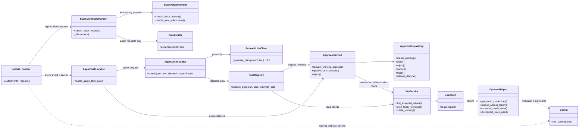

The model never reaches `JiraService` directly: `ToolRegistry` validates the plan against `ALLOWED_INTENTS`,
and the only write it can trigger is creating a PENDING approval.

## 4. Sequence diagrams

### 4.1 Connect, token refresh and disconnect

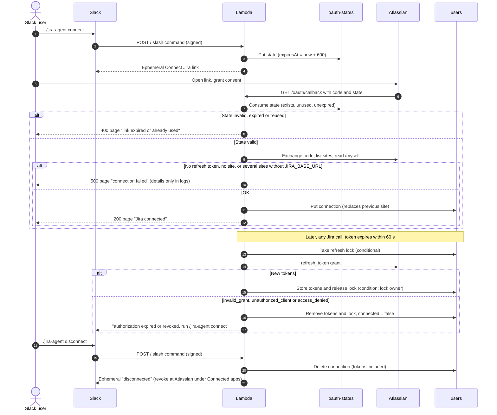

### 4.2 Read commands: `list` and `logwork today`

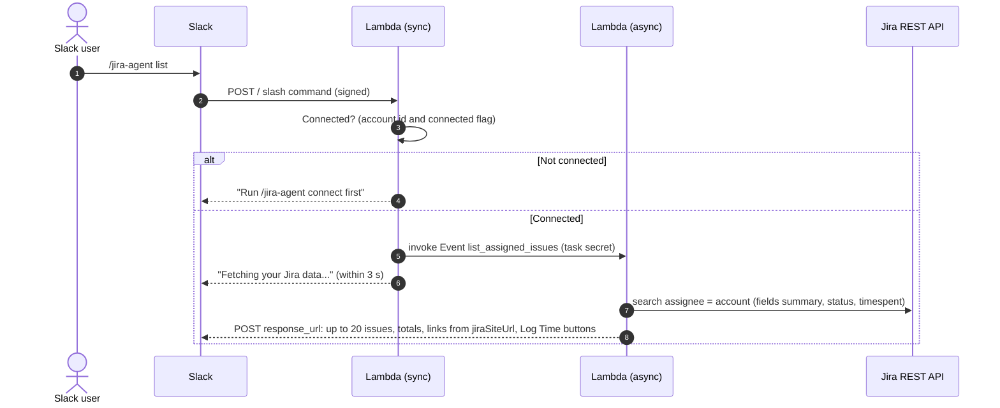

`logwork today` follows the same path with task `jira_worklog`: issues with worklogs today, then each issue's
worklogs filtered to the user and to today in the user's timezone (`timeZone`, else `JIRA_TIMEZONE`) (at most 23 shown; Slack allows 50 blocks).

`logwork find <keyword>` (alias `find <keyword>`) follows the same path with task `search_issues`:
- the keyword is reduced to plain terms (`jql_text_terms`: quotes, backslashes and JQL/Lucene operators removed,
  100 characters max), so user text can never change the JQL structure; an empty result gets a usage hint;
- LIKE-style matching (`jql_like_clause`): each word (at most 5) becomes a prefix match and all are required,
  `logi bu` → `text ~ "logi*" AND text ~ "bu*"`; one-character words are matched exactly. JQL has no SQL LIKE and
  Jira only allows a trailing wildcard, so "gin" cannot match "login";
- one search `<clause> ORDER BY updated DESC` with `maxResults` 21 (20 shown, the 21st only signals
  "more than 20 match"); if the keyword is an issue key it is also fetched directly and listed first;
- each row shows the link, status, total logged time (`timespent`) and a **Log Time** button that opens the
  existing modal, so the worklog still goes through the approval flow (4.3, 4.4).

### 4.3 Log Time modal → approval request (DM)

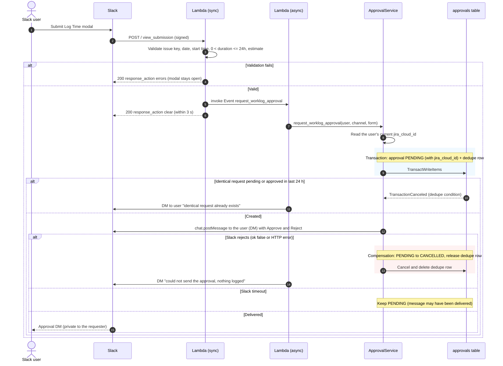

With `APPROVAL_DELIVERY=channel` the approval message is posted in the originating channel instead of a DM.

### 4.4 Approve → Jira worklog (the only write path)

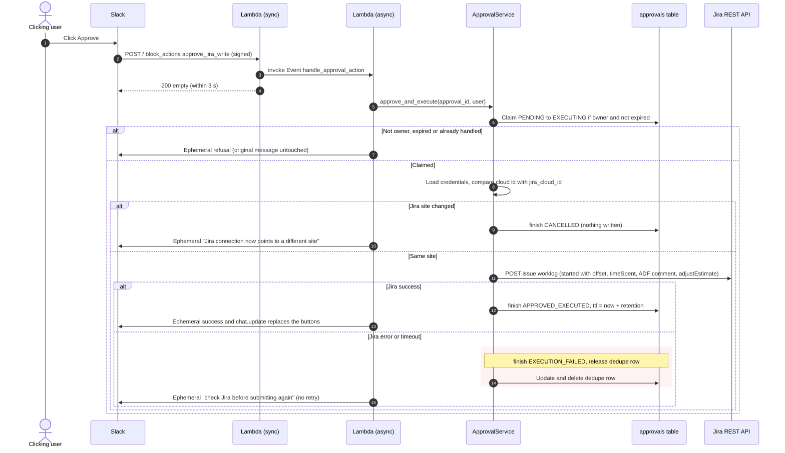

### 4.5 Natural-language request (agent)

> **Currently disabled** by the feature flag `AGENT_ENABLED=false` (template parameter `AgentEnabled`, default `false`).
> Free text is answered synchronously with the list of available commands, before the rate limit and without an async
> invoke; `agent_request` tasks already queued are answered the same way without calling Bedrock. The flow below applies
> when the flag is `true`.

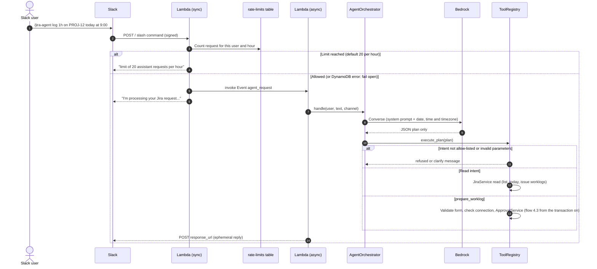

## 5. Processing steps – worklog from request to Jira

| Step | Layer | Action | Exception / branch | Result & compensation |
|:-:|---|---|---|---|
| 1 | `lambda_handler` | Verify Slack signature and timestamp (±300 s) | Bad or missing signature | `401 invalid Slack signature` |
| 2 | `SlackActionHandler` / `ToolRegistry` | Validate form: issue key, date, start time, `0 < duration <= MAX_WORKLOG_MINUTES`, estimate | Invalid field | Modal: errors per block. Agent: clarify. Nothing stored |
| 3 | `SlackActionHandler` | Invoke async task, ACK Slack | Invoke throttled (account concurrency) | `500` to Slack (`dispatch_failed`); throttles alarm |
| 4 | `ApprovalRepository` (transaction) | Create PENDING approval (with `jira_cloud_id`) and dedupe row | Live dedupe row exists | `DuplicateApprovalError` → DM, nothing stored |
| 5 | `ApprovalService` | Send Approve/Reject (DM by default) | Slack error / Slack timeout | Cancel + release dedupe + DM / keep PENDING |
| 6 | `ApprovalRepository` | Owner clicks Approve: conditional claim to EXECUTING | Not owner, expired, already handled | Ephemeral refusal, row unchanged |
| 7 | `ApprovalService` | Compare current Jira site with `jira_cloud_id` | Site changed | `CANCELLED`, nothing written |
| 8 | `JiraService` | POST worklog | Jira error or timeout | `EXECUTION_FAILED`, dedupe released, user told to check Jira; not retried |
| 9 | `ApprovalRepository` | Finish `APPROVED_EXECUTED`, `ttl` = retention | DynamoDB error after Jira success | `EXECUTION_FAILED`, dedupe **kept** (TC-29) |
| 10 | `AsyncTaskHandler` | Notify user; replace buttons only on success | Slack error | Logged, best effort |

## 7. Multi-workspace (Slack OAuth v2)

Every Slack identity is the pair (`team_id`, `slack_user_id`): Slack user ids are only unique inside a workspace.
Jira connections (`jira-agent-<stage>-jira-connections`, PK `team_id`, SK `slack_user_id`), approvals (owner check
`slack_user_id = :owner AND team_id = :team`), dedupe keys, rate-limit keys and OAuth states all carry `team_id`.
Slack calls use the bot token of the request's workspace: `slack_api(method, payload, team_id)`.

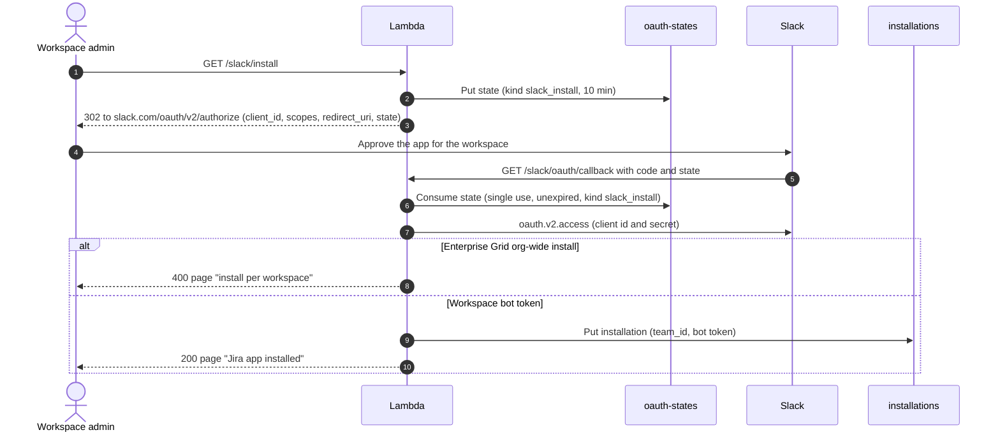

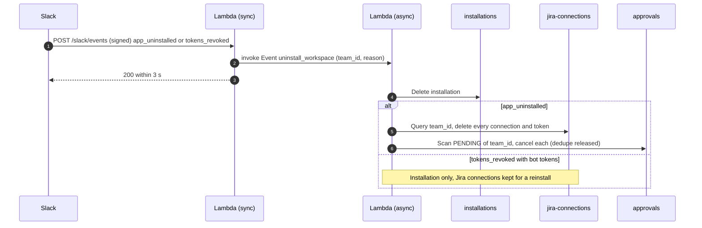

- A command from a workspace without an installation gets "hasn't installed the Jira app yet" with the install link.
- `url_verification` echoes the challenge; other events are acknowledged and ignored; events for another `api_app_id`
  are ignored when `SLACK_APP_ID` is set. Cleanup is idempotent, so Slack retries are harmless; a failed step still
  lets the others run and then fails the task into the async-failures queue.

## 6. Deployment and operations

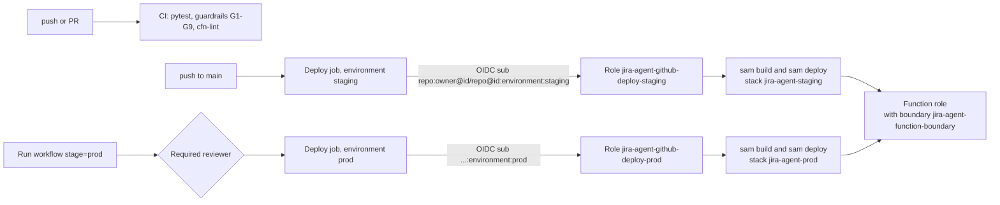

| Concern | How it is handled |
|---|---|
| Infrastructure | `template.yaml` (SAM). The HTTP API is declared with plain API Gateway v2 resources (Api, Integration, Routes, Stage, Lambda permission) so the function can reference the API id without a circular dependency |
| Deploy credentials | GitHub OIDC, no long-lived AWS keys. Trust is pinned to the immutable-id subject `repo:lolohoang123@6188421/jira_agent@1445373052:environment:<stage>` (`infra/github-oidc-bootstrap.yaml`) |
| Privilege escalation | Deploy roles may only create IAM roles carrying `jira-agent-function-boundary`, may never remove it, and may pass roles only to Lambda |
| Secrets | SSM SecureString under `/jira-agent/<stage>/`, created out of band; never in the template, GitHub or Lambda environment |
| Async failures | `MaximumRetryAttempts = 0` (tasks are not idempotent); uncaught failures go to the encrypted SQS queue (4 days) |
| Concurrency | `ReservedConcurrency` optional (default 0): the account limit is 10 and AWS keeps at least 10 unreserved. Raise the quota before opening prod widely |
| Alarms (SNS) | Lambda errors, throttles, p95 duration > 45 s, messages in the async-failures queue |
| Data safety | users and approvals tables: point-in-time recovery and `DeletionPolicy: Retain`. A failed **first** create leaves the retained tables behind; delete them (after checking they are empty) before redeploying |
| Invariants pinned by tests | `tests/test_infrastructure.py` (incl. a circular-dependency check that models SAM's implicit edges) and the guardrails skill |
